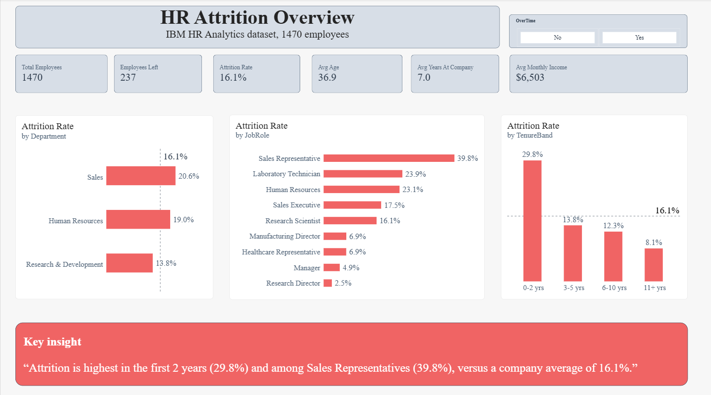
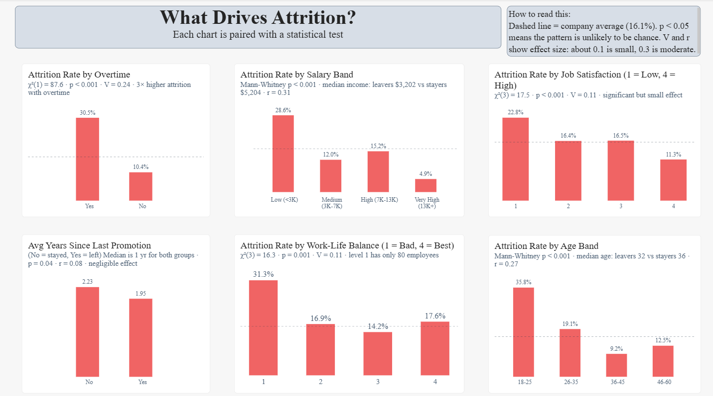
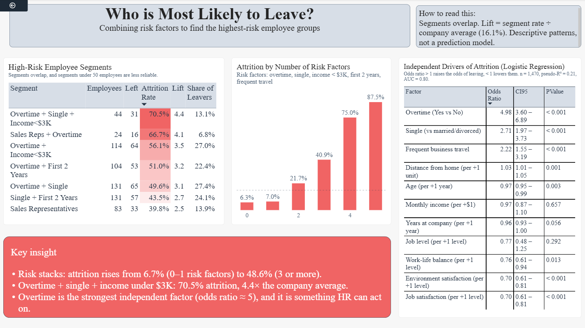
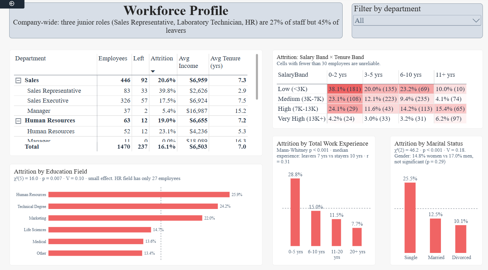

# HR Analytics & Employee Attrition Analysis

**SQL · Excel · Power BI (DAX) · Python · Statistics**

An end-to-end analysis of 1,470 employee records to find which workforce segments and job conditions are most associated with attrition, and to give HR leadership evidence for where retention effort will matter most. The work covers data cleaning in SQL, cross-validation in Excel, hypothesis testing and regression in Python, and a 4-page interactive Power BI dashboard built on a star schema.

---

## Dashboard preview

| Executive Overview | Attrition Drivers |
|---|---|
|  |  |

| High-Risk Segments | Workforce Profile |
|---|---|
|  |  |

A PDF export of the full dashboard is in [`powerbi/`](powerbi/).

---

## Business problem

Attrition costs an organisation recruitment spend, onboarding time, lost productivity and lost knowledge. Applying generic, company-wide retention policies is expensive and often misses the people most likely to leave. This project asks: **which employee segments are highest risk, which factors are statistically associated with leaving, and which of those can HR actually act on?**

## Key findings

Overall attrition is **16.1%** (237 of 1,470 employees).

| # | Finding | Evidence |
|---|---|---|
| 1 | **Overtime is the strongest and most actionable factor** | 30.5% attrition with overtime vs 10.4% without (about 3×). χ²(1) = 87.6, p < 0.001, Cramér's V = 0.24. Odds ratio ≈ 5.0 after controlling for other factors. |
| 2 | **Three junior roles drive a disproportionate share of leavers** | Sales Representatives (39.8%), Laboratory Technicians (23.9%) and HR staff (23.1%) are 27% of employees but 45% of leavers. |
| 3 | **The first two years are the danger zone** | 29.8% attrition at 0–2 years vs 8.1% at 11+ years. Low-paid employees in their first two years leave at 38.1%. |
| 4 | **Risk factors stack** | Attrition rises from 6.7% (0–1 risk factors) to 48.6% (3 or more). Overtime + single + income under $3K reaches 70.5% (44 employees, 4.4× the company rate). |
| 5 | **Pay matters, but is entangled with seniority** | Median income: leavers $3,202 vs stayers $5,204. Income is not significant in the regression once job level, age and tenure are included, because they are strongly correlated (Spearman 0.92 with job level). |
| 6 | **Some hypotheses were not supported** | Gender shows no significant association (p = 0.29). Years since last promotion has a negligible effect (r = 0.08). |

Full detail and recommendations: [`docs/insights_summary.md`](docs/insights_summary.md).

---

## Methodology

| Phase | What was done | Tool |
|---|---|---|
| 1–2 | Defined the business problem and KPIs; documented every column and flagged zero-information columns | Documentation |
| 3 | Cleaned the data and engineered `AgeBand`, `TenureBand`, `SalaryBand` and `AttritionFlag` | SQL (SQLite) |
| 4–5 | Exploratory analysis; mean vs median, cross-tabs, high-risk segment queries. Results cross-validated between SQL and Excel pivot tables (they match exactly) | SQL, Excel |
| 6–7 | Star schema (one fact table, five dimension tables) and DAX measures | Power BI |
| 8 | Four-page interactive dashboard with statistical annotations | Power BI |
| 9 | Chi-square, Mann-Whitney U, Spearman correlation, risk-factor stacking and logistic regression | Python |

### Statistical approach
- **Chi-square + Cramér's V** for categorical factors, so each association has both significance *and* an effect size.
- **Mann-Whitney U + rank-biserial r** for numeric variables, because income and tenure are skewed.
- **Logistic regression** (odds ratios with 95% CIs) to see which factors remain after controlling for the others.
- Group rates are read against the 16.1% base rate, because the classes are imbalanced.

### Data model
```
DimDepartment ─┐
DimJobRole ────┤
DimAgeBand ────┼──< EmployeeFact (1,470 rows)
DimTenureBand ─┤
DimSalaryBand ─┘
```
One-to-many relationships with single-direction filtering. Band dimensions use a `SortOrder` column so bands display in logical order.

### Selected DAX
```DAX
Attrition Rate = DIVIDE([Employees Left], [Total Employees], 0)

Overtime Attrition Gap = [Attrition Rate (OverTime)] - [Attrition Rate (No OverTime)]

Segment Lift = DIVIDE([Segment Attrition Rate], CALCULATE([Attrition Rate], ALL(EmployeeFact)))
```

---

## Repository structure

```
hr-attrition-analysis/
├── data/
│   ├── raw/                  original dataset (untouched)
│   ├── cleaned/              employees_clean.csv (output of the SQL cleaning script)
│   └── hr_attrition.db       SQLite database (employees_raw, employees_clean)
├── sql/
│   ├── 01_clean_data.sql             cleaning + derived columns
│   └── 02_exploratory_analysis.sql   KPIs, medians, cross-tabs, high-risk segments
├── excel/                    pivot-table workbook used to cross-validate SQL results
├── notebooks/
│   └── 03_statistical_analysis.ipynb  hypothesis tests and regression
├── powerbi/                  .pbix file + PDF export of the dashboard
├── docs/
│   ├── data_dictionary.md
│   └── insights_summary.md
├── screenshots/
├── requirements.txt
└── README.md
```

## How to reproduce

1. **SQL:** open `data/hr_attrition.db` in [DB Browser for SQLite](https://sqlitebrowser.org/), or run `sql/01_clean_data.sql` then `sql/02_exploratory_analysis.sql` against the raw table.
2. **Statistics:** `pip install -r requirements.txt`, then open `notebooks/03_statistical_analysis.ipynb` in Jupyter. It reads `data/cleaned/employees_clean.csv`.
3. **Dashboard:** open the `.pbix` in Power BI Desktop. If it reports a missing source, go to *Transform data → Data source settings* and point it at `data/cleaned/employees_clean.csv`.

---

## Limitations

- **Association, not causation.** The data is observational; nothing here proves that overtime (or anything else) *causes* people to leave.
- **Fictional dataset.** The IBM HR Analytics dataset is a publicly available fictional dataset, so the findings illustrate the method rather than describe a real company.
- **No dates.** Without hire or exit dates, true attrition trends over time cannot be analysed, so tenure bands are used instead of a time trend.
- **Risk factors were chosen after exploring this data**, so the stacking results are descriptive, not an out-of-sample prediction. The regression is likewise in-sample.
- **Ethics.** Marital status identifies who is at higher risk in this data but is a protected characteristic in many jurisdictions and should not be used for individual employment decisions.

## Possible next steps
Exit-interview text analysis, hire and exit dates for survival analysis, manager and team effects, the financial cost of attrition by role, and a held-out validation of any predictive model.

## Data source
IBM HR Analytics Employee Attrition & Performance dataset, available on [Kaggle](https://www.kaggle.com/datasets/pavansubhasht/ibm-hr-analytics-attrition-dataset). It is a fictional dataset created by IBM data scientists.

## Author
*Your name* · *LinkedIn* · *Email*
